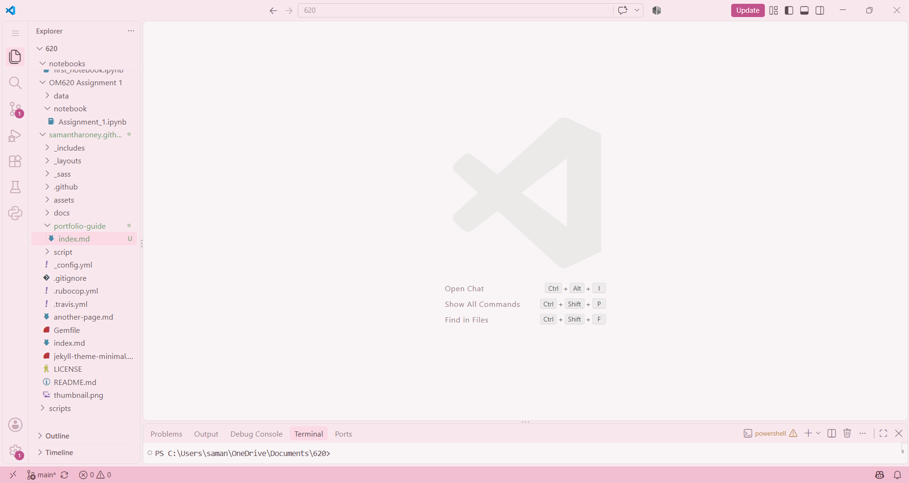
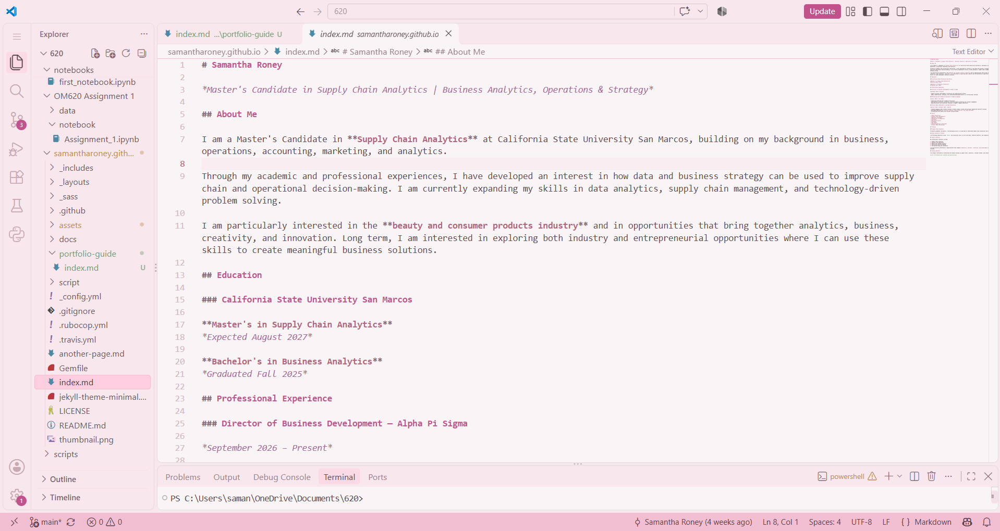
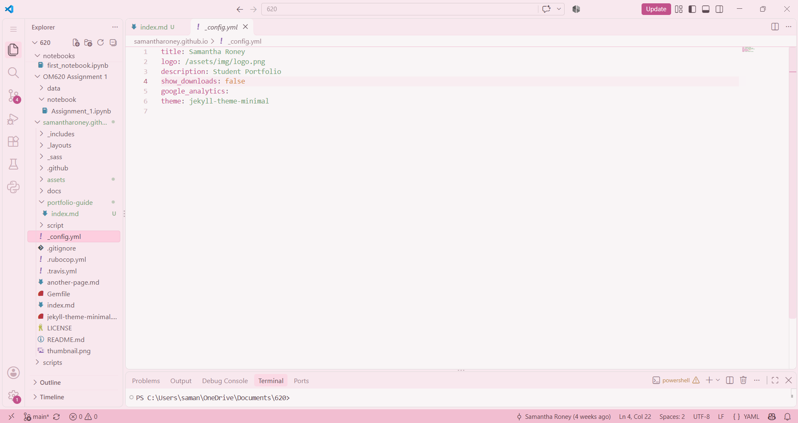
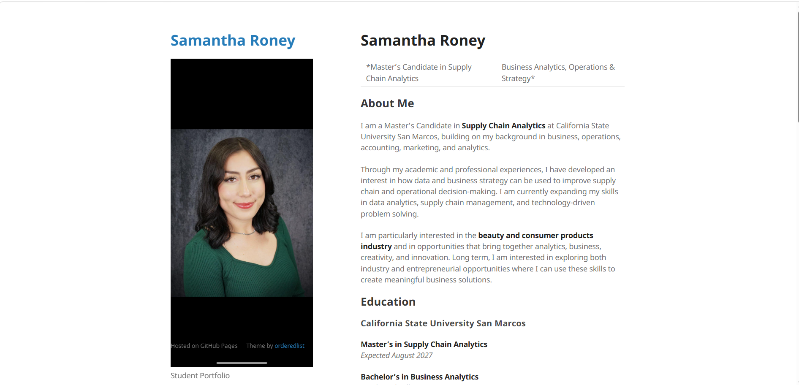

# How I Created My GitHub Pages E-Portfolio

## Introduction

An electronic portfolio, or e-portfolio, is a way to showcase my education, skills, experiences, and projects in one place. For my first milestone, I created a personal e-portfolio using GitHub Pages and the Minimal theme.

The purpose of this guide is to explain the process I followed to create and customize my e-portfolio. It includes the steps I took to set up my GitHub repository, work with Markdown files in Visual Studio Code (VS Code), customize the website, and publish it using GitHub Pages. I will also include screenshots to demonstrate the different stages of the process.

## 1. Creating the GitHub Pages Repository

The first step in creating my e-portfolio was setting up a GitHub repository. I created a new repository named `samantharoney.github.io`, which allowed me to host my personal website through GitHub Pages.

After creating the repository, I cloned it to my computer so I could work on the website locally using Visual Studio Code (VS Code). This allowed me to edit files, organize my project, and make changes before publishing them to GitHub.

## 2. Setting Up the Minimal Theme

After creating my GitHub repository, I used the Minimal theme provided by GitHub Pages as the starting point for my e-portfolio. The theme provided a basic website layout that I could customize instead of having to build a website from scratch.

I cloned the repository to my computer and opened the project folder in VS Code. The repository included several files and folders, including `index.md`, `_config.yml`, `assets`, and other theme-related files. These files provided the foundation for my website and allowed me to begin adding my own content and personalizing the design.

## 3. Customizing the Homepage

After setting up the Minimal theme, I began customizing my website by editing the `index.md` file in VS Code. This file contained the main content displayed on my homepage.

I wanted my e-portfolio to have a professional appearance, so I organized the information in a resume-style format. I added personal information, an introduction, education, skills, and experience to highlight my academic and professional background.

I used Markdown headings, text, and formatting to organize the different sections and make the information easy to read. This allowed me to turn the basic Minimal theme into a personalized e-portfolio that showcases my background and qualifications.

## 4. Adding a Profile Picture

To make my e-portfolio more personal, I added a professional headshot to my website. I placed the image inside the `assets/img` folder in my repository and named the file `logo.png`.

Next, I updated the `_config.yml` file to connect the image to my website by setting the logo path to `/assets/img/logo.png`. This allowed my headshot to appear on the portfolio alongside my personal information. I also made adjustments to the image to improve how it fit within the website layout.

## 5. Publishing the Website with GitHub Pages

After customizing my e-portfolio, I used Git to save and upload my changes to GitHub. I staged and committed my updated files with a commit message describing the changes, then pushed the updates to my GitHub repository.

GitHub Pages automatically built and published the website using the files in my repository. Once the process was complete, I opened my website in a browser to make sure it was working correctly and that my personal information and profile picture appeared as expected.

## 6. Final E-Portfolio

After completing the customization and publishing process, I reviewed my live e-portfolio to make sure everything appeared correctly. The final website includes my profile picture, introduction, education, skills, and experience.

## 7. Resources and References

The following resources helped me create and customize my e-portfolio:

- [GitHub Pages Documentation](https://docs.github.com/en/pages)
- [GitHub Minimal Theme](https://github.com/pages-themes/minimal) 
- [Visual Studio Code Documentation](https://code.visualstudio.com/docs/languages/markdown) 
